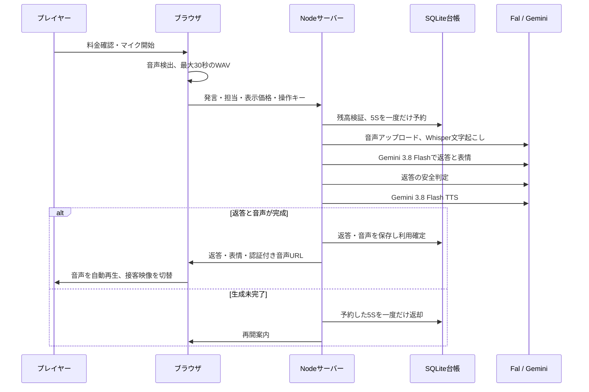

# SUCCUBUS NIGHT — 現在の構成

更新日：2026-10-09。ユーザーの最新指示を反映した、スマートフォン中心のローカルWeb版。

## サービスの流れ

1. アカウントにログインし、ルナ・ミオ・レイナから担当を選ぶ。
2. 入店映像から、選択したキャストと向かい合う席へ移る。
3. 購入済みSで自然な音声会話を行う。定型会話・主要な物語は無料。
4. 動画を任意に視聴して無料Gを獲得し、ドリンク・ギフトを贈る。
5. 会話・来店・イベント・ギフトでキャスト別の物語が進む。

## 通貨の役割

| 項目 | S | G |
| --- | --- | --- |
| 入手 | 日本円で購入する設計 | 動画視聴の報酬 |
| 使用 | 自然なAI音声会話 | キャストへのギフト |
| 現在の価格・報酬 | 1円=1S、返答1回5S | テスト動画30秒=100G |
| 相互交換 | なし | なし |
| 現金交換・送金 | なし | なし |

最新仕様では、すべてのギフトはGのみ。Sをギフトに使うリクエストはサーバーが拒否する。プレミアムボトルも18,000G。以前のG/S共通メニュー・S専用ボトル仕様は変更済み。

500Sなら料金5Sの返答を最大100回利用できる。残高不足時に自動購入しない。マイクを開始しただけではSを消費せず、発言を送信した時点で料金を予約する。

## 音声会話

- 音声入力：ブラウザのマイク→16kHz・モノラルPCM WAV。無音・形式不正・30秒超を課金前に拒否。
- 音声認識：Fal Whisper。実APIではdata URLが拒否されたため、サーバーからFalストレージにアップロードして認識する経路へ修正。
- 入力音声はローカルDBに保存しない。Falへはランダム名で送信し、900秒のストレージ期限を指定する。プロバイダー側のログ・保持ポリシーは別途確認が必要。
- 会話：Fal OpenRouter経由のGemini 3.8 Flash。直近8発言とキャスト設定を使用。
- 声：Luna/Aoede、Mio/Zephyr、Reina/Leda。表情に合わせた日本語の自然な成人女性の声。
- 無料の音声再生成・無制限のRealtime経路は無効。保存済み返答の聞き直しは追加消費なし。
- 同じ操作キーと同じ入力の再送は保存済み結果を返す。キーの使い回しで入力を変えることは禁止。
- 単一プロセス再起動時は未完了の予約を返却。複数サーバー化には永続ジョブと分散制御が必要。

実接続の確認：既存の生成挨拶をテスト入力に使い、音声認識→返答→音声生成→音声取得を完了。500S→495S、同じ操作の再送後も495S。所要約23秒。人間のマイク音声を使った試験記録ではない。詳細：[VOICE-VERIFICATION.json](VOICE-VERIFICATION.json)。マイクの開始状態はブラウザUIで別途確認。

## キャストの映像

- 成人の架空キャスト3人。選択した1人のみが席に表示される。
- imagegenでキャスト別の席の画像・表情参照画像を生成。
- Fal Kling 3 Proで、各キャストに待機・通常会話・喜び・悲しみ・軽い怒り・驚きの6種、合計18本の5秒映像を実生成。
- 開始・終了の参照画像を共通化し、2つのプレイヤーを重ねて切り替える。黒いリセット画面を避ける。
- 最初の案内映像は一度だけ再生し、終わる直前に席の映像へ移る。
- 返答のemotionに合わせて動画を切り替え、音声終了後は待機へ戻る。
- 発音単位の完全なリップシンクではない。映像・音声の新規API生成は再生のたびには行わない。
- MP4はRange配信・長期キャッシュ・ストリーミング配信。必要な担当・表情の素材だけ読み込む。

## 動画視聴と広告収益

現在はローカルのテスト動画。30秒の視聴確認で100G、テストの1日上限1,000G。中止可能で、視聴ノルマはない。

サーバーは視聴ID・所有者・経過時間・間隔を空けた視聴確認・付与済み状態を管理する。早期申請、他人の視聴ID、二重受取を拒否する。これは広告会社の収益確認や不正視聴防止を保証する仕組みではない。

**広告会社は未接続で、現在の視聴から広告収益は発生しない。** Web向けの候補はGoogle Ad Managerの任意参加型リワード広告。正式なアカウント・広告枠・コンテンツ審査・同意管理が必要。単価、配信率、地域等により収益は変わる。収益額は未確定。

Google Ad ManagerのWeb版にはアプリ向けSSVがない。クライアントのrewardイベントだけを、署名付きの広告証明と扱わない。正式接続時はGの付与上限・不正対策・照合方式を決める。Sの購入やAPI会話の残高と広告報酬を混ぜない。

公式資料：[Webリワード広告](https://support.google.com/admanager/answer/9116812?hl=ja)、[GPTの実装例](https://developers.google.com/publisher-tag/samples/display-rewarded-ad?hl=ja)、[報酬型広告の規則](https://support.google.com/admanager/answer/7496282?hl=ja)。

旧仕分けミニゲームの経済コードとテストは後方検証用に残るが、現在の利用画面は動画視聴へ変更。正式提供前に旧エンドポイントの整理が必要。

## 決済

- Stripe CheckoutのJPYテスト決済用。500・1,500・3,000・5,000円の4商品。
- Stripe接続はユーザー指定により待機。実Stripeのテストカード決済は未実施。
- サーバーによる金額・通貨・所有者・支払状態の確認、Raw Webhook署名、イベント・購入単位の重複防止。
- 月間購入上限、決済中の予約、通信断の照合、返金・異議申立ての整合。
- 本番キー・liveイベントを拒否。ローカル検証用Sは実決済ではなく、専用テストアカウントに用意したfixture。
- 本番の課金・料金請求は、ユーザーの承認後に準備する。今回ユーザーが承認したGitHubへの共有公開は、課金とAPI接続を含まない静的プレビュー。

詳細：[PAYMENTS.md](PAYMENTS.md)、[RELEASE.md](RELEASE.md)。

## 技術・保存先

| 層 | 主なファイル |
| --- | --- |
| Node.js 24 HTTPサーバー | `src/server.mjs` |
| 認証・CSRF | `src/auth.mjs` |
| 通貨台帳・注文・好意度 | `src/economy.mjs` / `src/catalog.mjs` |
| Stripeテスト接続 | `src/stripe.mjs` |
| 会話・音声認識・TTS | `src/ai.mjs` |
| 音声の料金予約・返却・音声保存 | `src/voice-turns.mjs` |
| テスト視聴・G付与 | `src/rewarded-views.mjs` |
| 画面・マイク・キャスト動画 | `public/app.mjs` / `voice-client.mjs` / `cast-stage.mjs` |
| 視聴画面・スマホ用スタイル | `public/reward-viewer.mjs` / `mobile.css` |
| 永続データ | `data/succubus.sqlite` / WAL |
| 生成素材 | `public/media/`、モデル・リクエストIDは`manifest.json` |

台帳は追記のみ、経済操作はSQLiteトランザクション。残高をブラウザから受け取らない。秘密鍵はサーバーの環境変数のみ。入力音声や秘密鍵をブラウザ保存領域に記録しない。

## UI/UXの方針

- スマホの下部に「ラウンジ・Gを獲得・物語」を固定。残高は上部で確認。
- 主な操作は44px以上。フォームは16px、本文は15〜16px。
- キャスト選択は横並び、音声開始を主操作とする。無料会話・映像設定は折りたたむ。
- フォント：本文Noto Sans JP、見出しZen Maru Gothic。WOFF2を同じサーバーから配信し、ライセンスを同梱。
- 意味の曖昧な説明カードを削除。必要な注意はフッターと確認画面にまとめる。料金・マイク許可の重要な確認は開始前に表示。
- 改善は「実機サイズで操作→問題を記録→修正→再操作」の有限の確認を繰り返す。[MOBILE-REVIEW.md](MOBILE-REVIEW.md)に実施結果を記録する。

## 接続待ち・追加が必要なもの

Stripe実接続、広告配信、自由会話のクラウドサーバーは未接続。GitHub Pagesへの静的共有プレビューを別途用意。現在のlocalhostはPCとサーバーが停止すると利用できない。クラウドでは常時起動するNode環境と永続DB・バックアップが必要。公開先と費用を決め、承認を得てから移行する。

発音に合う完全なリップシンク、広告の収益検証、販売事業者の承認・法務、アカウント復旧/削除、保持期限、監視、長期履歴のページング、ネイティブIAPも正式提供前の追加項目。

## 2026-10-09の追加改善

- Geminiの声だけを使用。Luna/Aoede、Mio/Zephyr、Reina/Leda。かわいい成人女性の声、親しみやすいため口。別事業者の音声やブラウザ読み上げへの自動切替はない。
- 挨拶・4話題・4ギフト×3人の27音声を事前生成し、無料会話とギフトは待ち時間なしで素材を再生。プレミアム2音声をセリフ修正後に再制作。
- マイクの入力レベル、静かな声の検出、入力音量補正、手動の「話し終えた」ボタンを追加。料金確認後はメインの音声ボタンから開始。人間の発話による聞き取り評価は利用者の実機で別途必要。
- テスト補充スクリプト `scripts/fund-local-test.mjs --all-local-accounts` は既存ローカルアカウントを50,000G・2,000Sまで補充。差分だけを追記台帳に記録し、実決済を行わない。HTTP経由の補充APIは作らない。
- 追加の実API試験は音声認識→カジュアルな返答→Gemini TTSを35.753秒で完了。490S→485S、同操作再送後も485S。合成した挨拶の入力による試験で、会話遅延が解消した結果ではない。
- 自動テスト55件成功。画面のG購入では50,000G→48,500G、Sは2,000のまま、好意度・乾杯音声が反映。マイク開始で入力メーターが動作し、停止時のS消費はない。

## 共有URLと公開方式

[共有プレビュー](https://kenx970-glitch.github.io/succubus-night-preview/) / [GitHub](https://github.com/kenx970-glitch/succubus-night-preview)。GitHub PagesはHTML/CSS/JS・動画・Gemini録音音声を配信する。共有デモはG/Sをブラウザ内で管理し、自由会話・マイク・実決済・ログインは動作させない。APIキー・ローカルDB・個人の履歴は含めない。PCを停止しても共有デモは見られる。Nodeサーバーを必要とする自由会話は、引き続きローカルPCで動く。

サーバー版 `public/` と共有版 `site/` は別。低遅延化・クラウド移行は [VOICE-OPTIONS.md](VOICE-OPTIONS.md) を参照。
